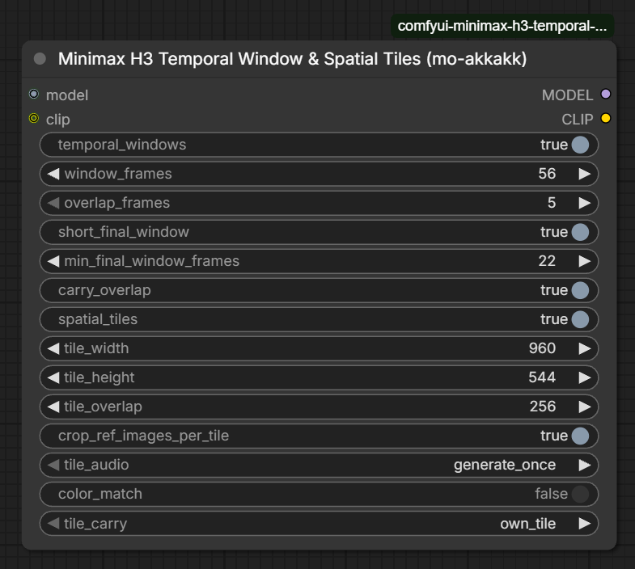

# Minimax H3 V2V Temporal Window & Spatial Tiles

by Mohamed ([mo-akkakk](https://registry.comfy.org/publishers/mo-akkakk))

Long and high-resolution video-to-video for the **open-weights MiniMax H3** in native ComfyUI. It is one node that goes after the model:

- **Temporal windows:** a long shot is generated as overlapping windows, one after another, each one continuing smoothly from the last.
- **Spatial tiles:** a big frame is generated as overlapping tiles, each following its own part of your plate (the reference video).

Both work in stage 1 (full denoise) and stage 2 (low-denoise refine).

The pack also has a second node, **Minimax H3 Long Generation**, for long text-to-video and image-to-video without a reference video, with a prompt timeline so the story moves forward. See [Long Generation node](#long-generation-node-text--image-to-video). Nothing inside the model is patched: every window and tile is an ordinary native H3 run. With one window and no tiles, the output is bit-identical to the plain native workflow.

## What's new

**1.1.0**
- New node: **Minimax H3 Long Generation (mo-akkakk)** for long text-to-video, image-to-video and first/last-frame generation. Windows are sampled one after another, each continuing from the previous one's finished frames, and an optional `prompt_schedule` (or a `Timeline:` in your prompt) gives every window the scene plus its own part of the story, re-timed in H3's native timeline format. See [Long Generation node](#long-generation-node-text--image-to-video).
- The V2V node is unchanged.

**1.0.9**
- The node is renamed *Minimax H3 V2V Temporal Window & Spatial Tiles*, to make clear it follows a reference video (V2V). Saved workflows keep working: only the displayed name changed.
- Clearer console message: without a reference video, the node now says every window uses the same prompt (which is expected), instead of warning that CLIP is not routed.

**1.0.8**
- **Exact tile crops (automatic).** When the plate is smaller than the output (always in stage 2, and in stage 1 above about 1 MP), each tile now gets exactly its own area of the plate. Before, the crop was rounded out to a coarse grid, so each tile followed a slightly zoomed or shifted plate and neighbouring tiles disagreed (shifting, doubling or changing content at tile overlaps). When plate and output are the same size, nothing changes.
- **New optional `plate` + `vae` inputs.** Reference to Video always shrinks reference videos to about 768p. Connect your full-resolution video to `plate` and each tile's plate piece is cut from it at full detail instead. See [The plate input](#the-plate-input-optional).
- **New `plate_scale` setting** to trade the plate's detail for speed.

**1.0.7**
- New `tile_carry` setting (default `own_tile`): with tiles and `carry_overlap`, each tile now continues from its own unblended frames of the previous window instead of the blended picture. Blending differences are no longer fed forward from window to window, so long tiled shots no longer slowly drift away from the plate. `blended` keeps the 1.0.6 behaviour.

**1.0.6**
- Spatial tiles are back to the 1.0.3 method: every tile is sampled on its own crop and the tiles are feather-blended. The 1.0.4 frozen-overlap tiles stitched badly in real use, in stage 1 and stage 2, and have been removed.
- `tile_audio`: `generate_once` now simply uses the first tile's soundtrack (no masks), instead of averaging one soundtrack per tile as 1.0.3 did. `keep_input` outputs the incoming audio untouched.
- `color_match` for tiles now compares each tile with the tiles already blended into its overlap.
- Kept from 1.0.4/1.0.5: guide clips crossing a window edge are cropped instead of dropped, guide latents are resized to the frame, the device fix.

**1.0.5**
- Fix: with spatial tiles on, 1.0.4 could stop with "Expected all tensors to be on the same device (cuda:0 and cpu)". The tile mask is now built on the GPU.

**1.0.4**
- Tiles now run one after another. Each tile is prefilled with its finished neighbours over the overlap: the outer half of that band is frozen and the inner half is blended in, so seams continue the neighbour instead of being averaged.
- New `tile_audio` setting. `generate_once` (default): the first tile makes the soundtrack and the other tiles keep it, instead of averaging one soundtrack per tile. `keep_input`: the incoming audio is kept untouched (stage 2).
- A guide clip that crosses a window edge is no longer dropped: the window keeps the 17-frame chunks inside it, plus the clip's audio.
- Guide latents at another resolution are resized to the frame before tiles crop them.
- New `color_match` switch (off by default): removes a small colour/brightness offset between tiles and between windows.
- Saved workflows keep their settings; the two new widgets are added at the end.

**1.0.3**
- New `short_final_window` switch (off by default): the last window can keep its natural shorter length instead of being pulled back to a full window.
- New `min_final_window_frames` (default 22): the shortest the last window may be when `short_final_window` is on.

**1.0.2**
- README and tooltips: spatial tiles also work in stage 1 when a plate (reference video) drives the shot.
- Removed the note that the plate must be 24 fps; testing showed it doesn't matter.

**1.0.1**
- New `temporal_windows` switch: turn windows off to run the whole length as one native pass (tiles still available).

**1.0.0**
- First release: sequential temporal windows with overlap carry and crossfade, per-window (and per-tile) prompt re-encoding, spatial tiles, works with KSampler and SamplerCustomAdvanced.

## Install

**ComfyUI Manager / Registry:** search for *Minimax H3 V2V Temporal Window & Spatial Tiles* (published as `comfyui-minimax-h3-temporal-window-spatial-tiles`; before 1.0.9 it was called *Minimax H3 Temporal Window & Spatial Tiles*).

**Manual:**
```
cd ComfyUI/custom_nodes
git clone https://github.com/mo-akkakk/ComfyUI-MiniMaxH3-TemporalWindow-SpatialTiles
```
Restart ComfyUI. It needs ComfyUI with native MiniMax H3 support (v0.35.0 or newer) and has no extra dependencies.

## Wiring

```
UNETLoader -> (shift / LoRA / low-VRAM patches) -> Minimax H3 V2V Temporal Window & Spatial Tiles -> BasicGuider or KSampler
CLIPLoader ------------------------------------> (clip in ... clip out) -> MiniMax H3 Reference to Video
Your video at output resolution (optional) ----> plate
VAE (optional, with plate) --------------------> vae
```

Everything else is the stock H3 workflow: Reference to Video (with your video as `ref_video_0`), Add Guide, SamplerCustomAdvanced or KSampler, and VAE Decode.

**Always route the CLIP through the node.** It records what Reference to Video encodes and re-encodes the prompt for every window and tile. Qwen then sees only that window's frames of `<Video 1>` (with timestamps from 0), cropped to that tile — exactly like a manually cut batch. Without this, every window reads a description of the whole shot and timing drifts.

- **Stage 1:** full sigmas.
- **Stage 2:** decode → upscale → VAE Encode → Concat AV Latent (with the stage-1 audio), or upscale the latent directly with [LBH-123-AI's MiniMax H3 latent upscaler](https://github.com/LBH-123-AI/Comfyui_Minimax_h3_latent_Upscaler). Then use a second copy of the node, usually with `spatial_tiles` on, and sample with low sigmas (see Tips).

## Settings

### Temporal windows

| Setting | What it does |
|---|---|
| `temporal_windows` | On: the shot is split into overlapping windows. Off: the whole length runs as one native pass (tiles still work). |
| `window_frames` | Frames per window, on H3's 17k+5 grid (124 = 5.2 s, 175 = 7.3 s). Keep it within what H3 handles accurately on your setup. |
| `overlap_frames` | Frames shared by neighbouring windows (5, 22, 39…). Bigger = smoother joins, a bit slower. 22 is a good default. |
| `short_final_window` | Off (default): the last window is pulled back to a full `window_frames`, re-generating some frames at the end. On: the last window keeps its natural shorter length, saving time. |
| `min_final_window_frames` | With `short_final_window` on: the shortest the last window may be (5, 22, 39, 56…). |
| `carry_overlap` | On (recommended): each window starts from the previous window's finished overlap frames (video and audio), so motion continues without a jump. |

### Spatial tiles

| Setting | What it does |
|---|---|
| `spatial_tiles` | On: each window is split into overlapping tiles. Needs a plate (a reference video): without one, a full-denoise pass in tiles repeats the subject in every tile. |
| `tile_width` / `tile_height` | Tile size in pixels. Use a size H3 handles well on your setup (for example 960 × 544, or about 1 MP). |
| `tile_overlap` | Pixels shared by neighbouring tiles, which are feather-blended there. Use 192 px or more. |
| `crop_ref_images_per_tile` | Also crop `<Picture N>` reference images to each tile. On when the picture is a frame of the shot (e.g. an edited first frame); off for character, product or style references. |
| `tile_audio` | `generate_once` (default): use the soundtrack generated by the first tile. `keep_input`: keep the incoming audio untouched — use it in stage 2 when the stage-1 audio is final. |
| `tile_carry` | With `carry_overlap`. `own_tile` (default): each tile continues from its own frames of the previous window, so long tiled shots don't slowly drift. `blended`: continue from the blended picture (1.0.6 and earlier). |
| `color_match` | Off by default. Removes a small colour/brightness step between a tile and its neighbours, and between a window and the previous one. Try it only if you see a tone step at seams. |

### The plate input (optional)

| Input / setting | What it does |
|---|---|
| `plate` | Your video at full resolution. Only used with `spatial_tiles` on. |
| `vae` | The video VAE, needed with `plate`. |
| `plate_scale` | Size of each tile's plate piece, relative to the tile. `1.0` = full detail (slowest). `0.5` = a quarter of the reference tokens: much faster, still exactly aligned and sharper than no plate. |

**Why use it.** Reference to Video always shrinks a reference video to about 768p, whatever size you generate. When you generate above about 1 MP, or refine in stage 2, every tile then follows a small, soft piece of that copy. With `plate` connected, each tile's piece is cut from your full-resolution video instead, so tiles follow real detail and stay locked to the original.

**How to feed it:**
- Keep your video connected to Reference to Video as `ref_video_0` as well — the node needs it for the prompt and timing, and only swaps in the sharper pieces. That copy can be small (e.g. 1 MP), since it is shrunk to 768p anyway.
- `plate` must be **the same clip**: same first frame, same frames, at least as long — just at higher resolution.
- Feed it at about **your output resolution**. A 4K plate works but takes a lot of RAM (about 100 MB per frame).

**Cost.** Each tile's plate piece is encoded once with the VAE before sampling, and bigger plate pieces mean more reference tokens at every sampling step. At `plate_scale` 1.0, expect a run to take about 1.6× as long as without the plate (in testing: 1330 s vs 812 s); lower `plate_scale` to get most of that time back.

## Tips

- **Write the prompt so it is true for every frame**, because each window reads it on its own.
- **This node is for video-to-video.** Windows follow the reference video, which tells each window where it is in the shot. With only text or a picture (no `ref_video_0`), every window gets the same prompt, so each window tends to act out the whole prompt again — a long story "restarts" every window. For text- or image-driven generation, use the **Long Generation** node instead.
- **Use H3's reference tags in the prompt:** `<Video 1>`, `<Picture 1>`, `<Audio 1>` (counting from 1 for each kind). These are the labels Qwen actually sees; input names like `ref_video_0` are not.
- **Avoid thin padding bars.** H3 works on 16 × 16-pixel blocks. If you pad a plate to round its size and the bars are thinner than about 16 px, H3 partly paints over them and the picture comes out slightly squashed and shifted. Use edge padding (repeat the last pixel), bars of 32 px or more, or crop instead of padding.
- **Stage 2: check your real sigmas.** `BasicScheduler` with `denoise` does not start at that amount of noise: with `linear_quadratic`, denoise 0.4 actually starts at sigma 0.93, almost a full re-generation, and windows and tiles will then disagree. For a refine, start around 0.2–0.45 (e.g. with ManualSigmas).
- **Seam where windows join:** increase `overlap_frames` (22 → 39).
- **Seam between tiles:** increase `tile_overlap`, then try `color_match`.
- **Fine texture flickering ("micro-boiling") at high resolution** comes mostly from the model and sampler (few-step LoRAs especially), not from tiling. Generating at about 1 MP and refining in stage 2 at low denoise is the most stable route to high resolution.

## Long Generation node (text / image to video)

**Minimax H3 Long Generation (mo-akkakk)** makes long videos from text, a first frame, or first and last frames — no reference video needed. Like the V2V node, it samples overlapping windows one after another, and each window continues from the previous window's finished frames, so the picture stays sharp and the character stays the same. What it adds is a **timeline**: each window is told only its own part of the story, so the story moves on instead of restarting every window.

### Wiring

```
UNETLoader -> (shift / LoRA / low-VRAM patches) -> Minimax H3 Long Generation -> BasicGuider or KSampler
CLIPLoader ----------------------------------> (clip in ... clip out) -> MiniMax H3 Image to Video (or Reference to Video)
```

Route the CLIP through the node — that is how it rewrites each window's prompt. Set the length on Image to Video (e.g. 481 frames = 20 s at 24 fps).

### Writing the prompt

Split it into two parts:

1. **The scene** — in the conditioning node's prompt box (Image to Video or Reference to Video). Everything that is true for the whole video: the look, the character, the places, the camera, the audio. Every window gets it unchanged.
2. **The timeline** — in the node's `prompt_schedule`: only the actions, each with the second it starts.

**Scene** (Image to Video prompt):
```
A cinematic medium shot of a young man with short dark hair, round glasses and a brown wool coat, walking along a quiet snowy city street at dusk, past small shops. Just ahead on his right is a small bakery with a warmly lit window full of cakes and a wooden door. Warm shop lights, light falling snow, handheld camera following him from the front. No text on signs.
```

**Timeline** (`prompt_schedule`):
```
0s: he walks slowly along the street toward the camera
5s: he slows down and stops in front of the bakery window
10s: he smiles and points at a cake behind the glass
15s: he pushes open the bakery door and steps inside
```

Each window then gets the scene plus the part of the timeline it covers, re-timed so the window starts at 0 s — the way MiniMax's own templates write prompts. For example, a window covering 7.1–12.2 s gets:
```
<the scene>

Timeline:
[0s-2.9s] he slows down and stops in front of the bakery window
[2.9s-5.2s] he smiles and points at a cake behind the glass

One continuous shot, no cuts.
```
The console prints every window's prompt, so you can check what each one received.

You can also write the timeline H3's own way, `[5s-10s] he stops at the bakery window`, either in `prompt_schedule` or as a `Timeline:` block inside the conditioning prompt — with `prompt_schedule` left empty, a timeline in the prompt is re-timed per window automatically.

**Rules of thumb:**
- **The scene says *where* everything is; the timeline says *when* things happen.** Put every place and object the story needs into the scene (the bakery, the door…). If an action needs something that is not in the shot yet, H3 tends to cut to it.
- **Describe the character the same way throughout** — the scene does that for you, so keep identity details out of the timeline.
- **One small action per line**, each continuing from the previous one. Give each action a few seconds; actions closer together than about one window are compressed.
- **Reference to Video works too:** put the tags in the scene (`<Picture 1> is the man, <Picture 2> is the bakery`), and use them in the timeline if you like. Pictures and reference audio are shown to every window. For a soundtrack that must play in time across the video, add it with Add Guide (audio) at frame 0 instead of as reference audio.

### Settings

| Setting | What it does |
|---|---|
| `prompt_schedule` | The timeline, one action per line: `5s: text` or `[5s-10s] text`. Empty = a `Timeline:` in the conditioning prompt is used; with none, every window uses the prompt as it is. |
| `continuous_shot` | On (default): adds "One continuous shot, no cuts." to every window's prompt, so H3 continues the carried frames instead of cutting when the action changes. Turn off if you want cuts. |
| `window_frames` | Frames per window (17k+5). 124 = 5.2 s. |
| `overlap_frames` | Frames each window takes over from the previous one (5, 22, 39…). Without a reference video the overlap is what carries the motion forward: 39 recommended. |
| `short_final_window` / `min_final_window_frames` | As in the V2V node. |
| `carry_overlap` | On (default): each window starts from the previous window's finished frames. Keep it on. |
| `first_last_images` | For Image to Video. `own_window` (default): the first image is in the first window's prompt only, the last image in the last window's only — matching where they are used as frames. `all_windows`: every window's prompt shows both (can hold a look, but later windows may drift back toward the first frame). |

There are no tiles in this node: without a reference video, tiles would each draw the whole scene. For a high-resolution result, generate at about 1 MP here, then upscale and refine it with the V2V node, using your generated video as the plate.

### Limits

- When the action changes a lot, or needs a place that is not in the shot yet, H3 may still cut to a new camera angle. Describing every place in the scene and keeping actions small and continuous helps most.
- At each window join, motion can hesitate for a frame or two where the new window takes over.
- ComfyUI's native **MiniMax H3 Context Windows** node is an alternative: it blends all windows at every step, which avoids hand-off moments but in our side-by-side test gave a noticeably softer picture and a character whose look slowly changed.

## How it works

The node registers an `OUTER_SAMPLE` wrapper on the model, so it works with any guider and sampler. For each window:

1. It slices the noise and latent to the window, and the audio to the matching span on H3's 40 Hz audio grid.
2. It re-times the native conditioning to the window: reference-video latents are sliced, guide frames are moved to window time (a guide clip crossing the window edge keeps its 17-frame chunks inside the window).
3. It appends the previous window's finished overlap as a guide clip at frame 0.
4. It swaps in the per-window prompt encoding.
5. With tiles, it runs each tile on its own crop of everything above — noise, latent, plate, guides and prompt — and feather-blends the tiles.
6. It crossfades the window into the output.

Windows start on H3's 17-frame VAE-clip boundaries, so every window and every carried overlap is a valid H3 length.

## Tests

```
python custom_nodes/ComfyUI-MiniMaxH3-TemporalWindow-SpatialTiles/tests/test_windows.py
```

Run this from the ComfyUI root. The tests run ComfyUI's real H3 conditioning, model and sampler code on CPU, with a tiny random-weight DiT and recording stand-ins for Qwen and the VAE. They check, among other things, that:

- a single window is bit-identical to native sampling;
- each window gets its own slice of the plate, and the overlap carry is correct;
- the per-window prompt shows only that window's frames, with timestamps from 0;
- it works through KSampler, and tiles work with full and partial sigmas;
- each tile's plate crop lands exactly on the tile, and is a plain slice when plate and output are the same size;
- with `plate`, every tile's reference is encoded from its exact crop of the plate, and `plate_scale` sizes it;
- each tile continues from its own frames (`tile_carry`), and the soundtrack comes from the first tile (or the input);
- Long Generation: the timeline is parsed and re-timed per window, each window's prompt is the scene plus its own part of the timeline, and first/last images go only to their own window.

## Limits

- Tiles are sampled independently and blended afterwards, so very flat areas (sky, walls) can show slight differences between tiles. A wider `tile_overlap` helps, and `color_match` can help with tone steps.
- Everything outside the plate (new content your prompt adds) is invented separately per tile and window, so keep the prompt consistent and the overlaps generous.

## Credits

The guide resize and the colour match are adapted from ideas in [LBH-123-AI's MMH3 Split Upscale](https://github.com/LBH-123-AI/Comfyui_Minimax_h3_latent_Upscaler) (MIT). Cropping guide clips at 17-frame chunks follows the native MiniMaxH3ContextWindows support in ComfyUI.

## License

MIT, © 2026 Mohamed ([mo-akkakk](https://registry.comfy.org/publishers/mo-akkakk)).
